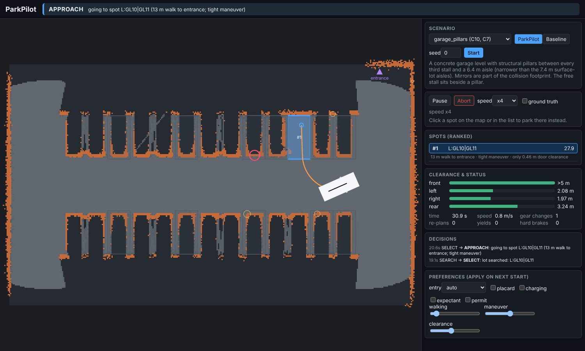
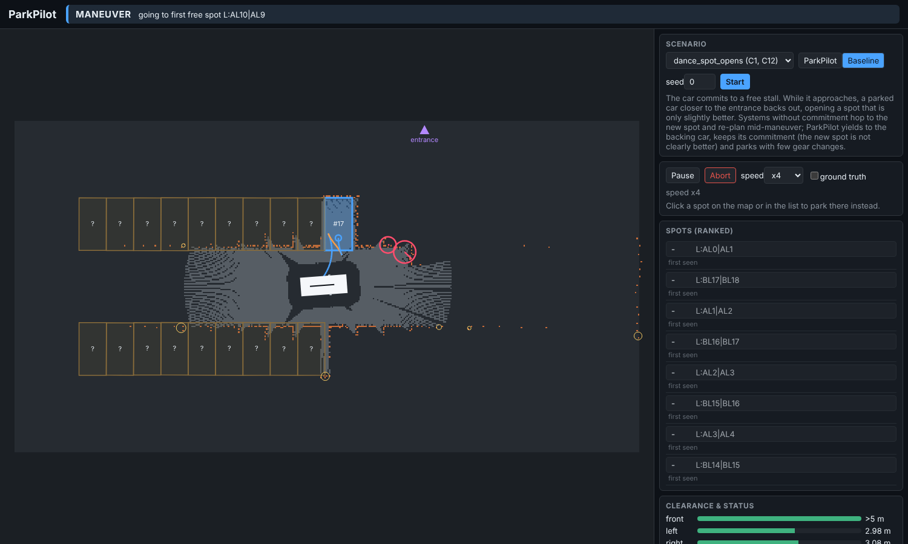

# ParkPilot

A 2D simulated autonomous parking stack, built to show measurable engineering responses
to the most common owner complaints about consumer "self-driving" parking features:
indecisive shuffling, crawling, crooked parking, bad spot choice, parking in restricted
places, close-range blindness, phantom braking and more. It is a research simulator, not a
product, and has no affiliation with any manufacturer.

- **Backend** (Python 3.12, numpy, pydantic, FastAPI): simulated camera-only perception
  with an occupancy grid that remembers, lined and line-less spot detection with legality
  rules, destination-aware explainable ranking, Hybrid A* with Reeds-Shepp, final-pose
  refinement, a safety supervisor, and a decision state machine with commitment and a
  fallback ladder.
- **Frontend** (TypeScript, React, Canvas 2D): live HMI with the chosen spot, ranked
  alternatives and reasons, the planned path, the current state and why, clearance
  gauges, click-to-override, pause/abort/speed and a baseline toggle.

Motivation and the complaint-to-capability map: [docs/PROBLEM_STATEMENT.md](docs/PROBLEM_STATEMENT.md).



## Before / after

`make bench` runs all 16 scenarios x 5 seeds for ParkPilot and a deliberately naive
baseline (first visible spot, no legality checks, no gear-change penalty, timed
re-planning, memoryless single-frame perception, no persistence filter, constant crawl,
line-centred nose-in, no fallback). Full report: [docs/BENCHMARK.md](docs/BENCHMARK.md).

| Metric | Baseline | ParkPilot |
|---|---:|---:|
| Park success rate (excl. expected handbacks) | 60% | 99% |
| Collisions (total) | 7 | 0 |
| Curb contacts (total) | 35 | 0 |
| Legality violations (total) | 10 | 0 |
| Missed hazards (total) | 0 | 0 |
| False stops (total) | 745 | 30 |
| Gear changes per park | 8.9 | 2.1 |
| Re-plans per park | 19.3 | 0.1 |
| Time to park (s) | 60.1 | 44.4 |
| Mean speed (m/s) | 0.58 | 1.16 |
| Peak jerk (m/s^3) | 44.3 | 24.4 |
| Final lateral error (m) | 0.09 | 0.06 |
| Final heading error (deg) | 2.8 | 1.5 |
| Min side clearance at rest (m) | 0.99 | 0.84 |
| Walking distance (m) | 16.7 | 13.0 |
| Selection matches oracle | 24% | 86% |
| Abort/handback with reason | 0% | 100% |

Across 160 runs ParkPilot had 0 collisions, 0 curb contacts, 0 legality violations and 0
missed hazards. "Min side clearance at rest" is lower for ParkPilot only because the
baseline mostly ends up in roomy stalls far from the entrance.



## Quickstart

Requirements: [uv](https://docs.astral.sh/uv/), Node 22 with pnpm, and Chromium for the
end-to-end test.

```bash
make install     # uv sync + pnpm install
make dev         # backend on :8000, Vite on :5173 (proxying /api and /ws)
# open http://localhost:5173, pick a scenario (e.g. garage_pillars, charger_stall,
# unmarked_lot) and press Start
make test        # backend pytest (coverage >= 85%) + frontend vitest
make lint        # ruff, ruff format, mypy --strict, tsc, eslint, prettier
make bench       # full A/B benchmark -> docs/BENCHMARK.md and docs/img/bench_*.png
make e2e         # Playwright: start both servers, park in charger_stall
make schema      # export the protocol JSON Schema and regenerate TS types
```

CLI: `uv run parkpilot list | serve | bench | export-schema` (from `backend/`).

## Controls

| Control | What it does |
|---|---|
| Scenario, ParkPilot/Baseline, seed, Start | start a run of either system on any scenario |
| Click a spot (map or list) | override the choice; the car acknowledges and re-plans, and the choice is remembered for that location |
| Pause / Resume, speed | pause the sim or run it at 0.5x-8x |
| Abort | stop safely and hand back control |
| Ground truth | overlay true obstacles, agents and zones (debug) |
| Preferences | entry direction (auto, nose-in, reverse-in, pull-through), unlocks (placard, charging, expectant, permit), ranking weights |
| Mouse drag / wheel | pan / zoom |

Map legend: green = eligible (with rank), blue = chosen, red X = restricted, amber ? =
not yet verified, grey = occupied, dashed = line-less (inferred) stall; blue/orange path
= forward/reverse; red circles = confirmed moving agents.


## Architecture

Python backend under `backend/parkpilot/` with the dependency direction
`core <- vehicle/world <- perception <- spots/planning <- behavior <- sim <- api`; the
planner and behavior layers only see perception output, never ground truth. The browser
frontend renders frames and sends commands; it has no autonomy logic. The pydantic wire
protocol is exported as JSON Schema and compiled to TypeScript, and CI fails on drift.
Details: [docs/ARCHITECTURE.md](docs/ARCHITECTURE.md), [docs/PROTOCOL.md](docs/PROTOCOL.md),
and the ADRs in [docs/adr/](docs/adr/).


## Known limitations

- 2D only: no heights beyond a "low object" flag, no ramps, no 3D garage structure.
- Simulated perception: ray-cast depth with noise models, not real images; painted-line
  observations carry their identity (data association is simulated). No real sensor data.
- Kinematic bicycle model, not a dynamic one (no tyre slip, no load transfer).
- Ego localization is assumed perfect.
- Planning latency is not simulated (the sim pauses while Hybrid A* runs).
- Line-less inference only offers gaps between two parked vehicles, not open row ends.
- Pure Python: Hybrid A* runs ~1-2 ms per expansion; nose-in through a 6.4 m garage aisle
  can exhaust the search budget (the car then tries reversing in or another spot).
- The baseline re-plans on a 2 s timer rather than every perception frame (every frame
  would be slower to benchmark and only worse for the baseline).

## Where ParkPilot still underperforms

- `garage_pillars`: 4/5 seeds park; in one seed Hybrid A* cannot find a reverse-in path
  through the 6.4 m aisle within its expansion budget and the car hands back.
- Charger alignment: the port ends up 1.16 m (`charger_stall`) and 1.31 m
  (`home_garage`) from the charger, against a 0.5 m target; pulling in is limited by the
  goal's extra safety slack, and in the home garage this is just past the 1.2 m reach.
- Parallel parking ends with ~3.5 deg heading error: paths there end on an arc, which the
  controller cannot fully unwind (perpendicular paths end with a straight segment).
- `dynamic_agents`: about 17 s lost yielding per run; conservative TTC margins make it
  wait for agents that would have cleared.
- A small number of false stops remain (30 over 80 runs), mostly yields to clutter that
  briefly looks like a mover at night or near parked-car outlines.
- Peak jerk (~24 m/s^3) is dominated by stop transients at cusps, not cruising.
