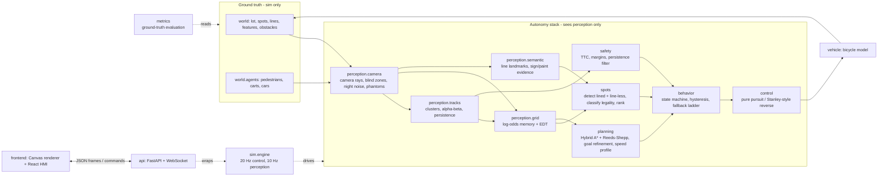

# Architecture

ParkPilot is a monorepo with a Python simulation and autonomy backend and a TypeScript
browser HMI. The simulation is fully headless: the API server and the benchmark are two
consumers of the same `Simulation` class.

## Dependency direction

`core <- vehicle/world <- perception <- spots/planning <- behavior <- sim <- api`, with
`safety` and `control` alongside `planning`, `metrics` and `baseline` on top of `sim`.
There are no cycles. Ground truth (`world`, `world.agents`) is read only by
`perception.camera` (through the simulated sensor), `sim.truth`, `metrics` and the debug
layer of `api.frames`.

## Backend modules

| Module | Responsibility |
|---|---|
| `core` | SE(2) poses, convex polygons, SAT, units, every tunable in typed pydantic config (`core/config.py`). |
| `vehicle` | Kinematic bicycle model with actuator limits, footprint with mirrors, covering disks, charge-port location. |
| `world` | Ground truth: typed spots and painted lines, legality features (signs, paint, curb ramps, driveway aprons, hatching, chargers), no-parking zones, obstacles, dynamic agents. |
| `scenarios` | YAML scenario format and loader; 17 scenarios covering C1-C15. |
| `perception` | Camera-only rays (no ultrasonics) with near-field blind zones, lighting-dependent noise/range/dropout, occlusion and false positives; tracker with persistence filter and motion evidence; log-odds occupancy grid with memory and a capped exact EDT; semantic map. |
| `spots` | Lined detection (mutual-nearest line pairs), line-less detection (gaps between vehicle components along the aisle), conservative legality classification, destination-aware cost with reasons. |
| `preferences` | `PreferenceRepository` protocol, in-memory and atomic JSON-file stores, per-location favorites. |
| `planning` | Reeds-Shepp (all 48 words), Hybrid A* (gear-change, reverse, steering and clearance costs, obstacle-aware Dijkstra + RS heuristic, RS analytic expansion, final straight), exact footprint-vs-grid collision checks, final-pose refinement, clearance/curvature/steer-rate speed profile. |
| `control` | Pure pursuit forward; Stanley-style reverse on a virtual vehicle with curvature feedforward; jerk-limited speed control with stopping feedforward. |
| `safety` | Uncertainty-inflated margins, static path sweep on the memory grid, TTC against predicted movers, reverse-light intent cue, persistence filter. |
| `behavior` | SEARCH -> SELECT -> APPROACH -> MANEUVER -> REFINE -> PARKED, plus YIELD, REPLAN, FALLBACK, HANDBACK; commitment hysteresis; fallback ladder; reasons for every transition. |
| `sim` | Fixed-timestep engine, scripted commands, ground-truth monitor. |
| `metrics` | Per-run metrics, oracle spot choice, parallel benchmark, Markdown/PNG report. |
| `baseline` | The naive comparison stack (see `docs/BENCHMARK.md`). |
| `api` | Versioned wire protocol, frame builders, session manager, REST + WebSocket server. |
| `cli.py` | `parkpilot serve | bench | list | export-schema`. |

## Frontend

`net` (typed client with reconnect) -> `store` (zustand, latest frame and decoded grid) ->
`render` (Canvas 2D renderer with its own camera, reading the store every animation frame)
and `hmi` (React panels subscribing to small slices). The frontend has no autonomy logic:
it renders frames and sends commands. Types in `src/generated` come from the backend
schema.

## Key data flow per tick (50 ms)

1. Agents move (ground truth).
2. Every second tick: camera rays -> tracks -> grid and semantic map.
3. Scripted commands (benchmark overrides) fire.
4. Behavior: re-detect and re-rank spots at 2 Hz; run the current state; the safety
   supervisor caps speed or commands an emergency stop; the follower produces
   acceleration and steering.
5. The bicycle model integrates; the truth monitor records clearances and contacts.

See the ADRs in `docs/adr/` for the main design decisions.
