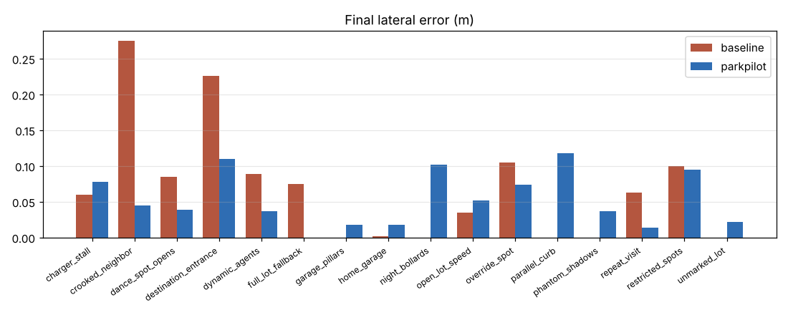
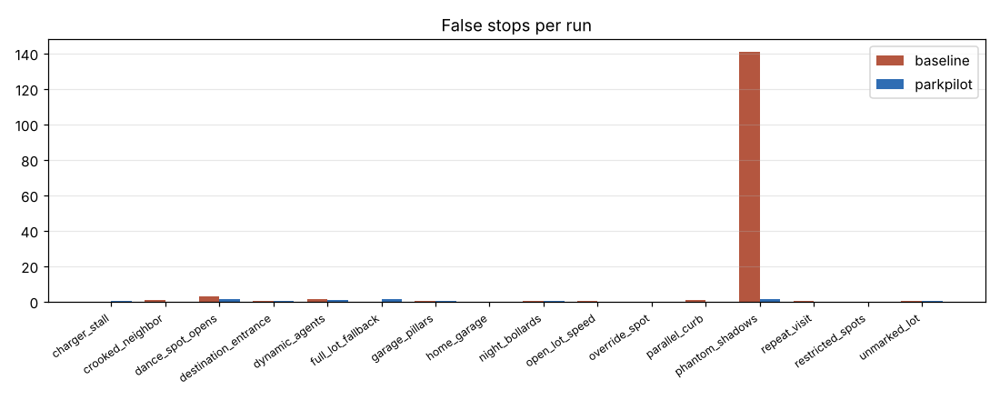

# Benchmark

Generated by `make bench` (`parkpilot bench`). Every scenario runs for both systems
over 5 seeds; numbers are computed from ground truth by
`parkpilot/metrics/run_metrics.py`. Nothing here is hand-edited.

Means over *parked* runs are marked; totals and rates are over all runs. Expected
handbacks (`full_lot_fallback`) are excluded from the success rate.

## Headline

| Metric | Baseline | ParkPilot |
|---|---:|---:|
| Park success rate (excl. expected handbacks) | 60% | 99% |
| Collisions (total) | 7 | 0 |
| Curb contacts (total) | 35 | 0 |
| Legality violations (total) | 10 | 0 |
| Missed hazards (total) | 0 | 0 |
| False stops (total) | 745 | 30 |
| Gear changes per park | 8.9 | 2.1 |
| Re-plans per park | 19.3 | 0.1 |
| Time to park (s) | 60.1 | 44.4 |
| Mean speed (m/s) | 0.58 | 1.16 |
| Peak jerk (m/s^3) | 44.3 | 24.4 |
| Final lateral error (m) | 0.09 | 0.06 |
| Final heading error (deg) | 2.8 | 1.5 |
| Min side clearance at rest (m) | 0.99 | 0.84 |
| Walking distance (m) | 16.7 | 13.0 |
| Selection matches oracle | 24% | 86% |
| Abort/handback with reason | 0% | 100% |

## Per complaint

| # | Scenario | Metric | Baseline | ParkPilot |
|---|---|---|---:|---:|
| C1 | `dance_spot_opens` | gear changes | 8.4 | 1.4 |
| C1 | `dance_spot_opens` | re-plans | 21.4 | 0.0 |
| C2 | `open_lot_speed` | mean speed (m/s) | 0.74 | 1.87 |
| C2 | `open_lot_speed` | time to park (s) | 94.8 | 41.6 |
| C3 | `crooked_neighbor` | lateral error (m) | 0.27 | 0.04 |
| C3 | `crooked_neighbor` | min side clearance (m) | 0.30 | 0.47 |
| C4 | `destination_entrance` | oracle match | 0% | 100% |
| C4 | `destination_entrance` | walking distance (m) | 42.4 | 11.3 |
| C5 | `restricted_spots` | violations | 1.0 | 0.0 |
| C6 | `unmarked_lot` | success rate | 0% | 100% |
| C7 | `night_bollards` | collisions | 0.0 | 0.0 |
| C7 | `night_bollards` | min clearance (m) | 0.63 | 0.41 |
| C8 | `phantom_shadows` | false stops | 140.8 | 1.2 |
| C8 | `phantom_shadows` | missed hazards | 0.0 | 0.0 |
| C9 | `parallel_curb` | success rate | 0% | 100% |
| C9 | `parallel_curb` | curb distance error (m) | n/a | 0.12 |
| C10 | `garage_pillars` | success rate | 0% | 80% |
| C10 | `garage_pillars` | min clearance (m) | 0.79 | 0.34 |
| C11 | `charger_stall` | port-to-charger (m) | n/a | 1.16 |
| C11 | `home_garage` | port-to-charger (m) | 5.85 | 1.31 |
| C12 | `dynamic_agents` | collisions | 0.2 | 0.0 |
| C12 | `dynamic_agents` | yield events | 0.0 | 4.0 |
| C12 | `dynamic_agents` | time lost yielding (s) | 0.0 | 17.5 |
| C13 | `override_spot` | parked in driver's choice | 100% | 100% |
| C14 | `full_lot_fallback` | handback with reason | n/a | 100% |
| C14 | `full_lot_fallback` | violations | 1.0 | 0.0 |
| C15 | `repeat_visit` | repeat-visit match | 100% | 100% |
| C15 | `repeat_visit` | preference honored | 100% | 100% |

## Per scenario

| Scenario | System | parked | t park | gears | replans | lat err | hdg err | min clr | coll | viol | false stops | missed |
|---|---|---:|---:|---:|---:|---:|---:|---:|---:|---:|---:|---:|
| `charger_stall` | baseline | 100% | 51.7 | 9.2 | 17.6 | 0.06 | 2.0 | 0.34 | 0.0 | 0.0 | 0.0 | 0.0 |
| `charger_stall` | parkpilot | 100% | 41.3 | 2.6 | 0.2 | 0.08 | 4.5 | 0.55 | 0.0 | 0.0 | 0.2 | 0.0 |
| `crooked_neighbor` | baseline | 20% | 73.1 | 18.8 | 35.2 | 0.27 | 0.4 | 0.08 | 0.8 | 0.0 | 0.8 | 0.0 |
| `crooked_neighbor` | parkpilot | 100% | 33.9 | 1.0 | 0.2 | 0.04 | 1.3 | 0.39 | 0.0 | 0.0 | 0.0 | 0.0 |
| `dance_spot_opens` | baseline | 100% | 73.1 | 8.4 | 21.4 | 0.09 | 4.9 | 0.28 | 0.2 | 0.0 | 3.0 | 0.0 |
| `dance_spot_opens` | parkpilot | 100% | 43.0 | 1.4 | 0.0 | 0.04 | 1.1 | 0.56 | 0.0 | 0.0 | 1.4 | 0.0 |
| `destination_entrance` | baseline | 100% | 60.9 | 13.4 | 30.2 | 0.23 | 3.0 | 0.28 | 0.0 | 0.0 | 0.4 | 0.0 |
| `destination_entrance` | parkpilot | 100% | 52.7 | 4.2 | 0.2 | 0.11 | 1.4 | 0.39 | 0.0 | 0.0 | 0.2 | 0.0 |
| `dynamic_agents` | baseline | 80% | 68.7 | 8.6 | 22.0 | 0.09 | 3.3 | 0.27 | 0.2 | 0.0 | 1.2 | 0.0 |
| `dynamic_agents` | parkpilot | 100% | 73.6 | 1.8 | 0.0 | 0.04 | 1.7 | 0.44 | 0.0 | 0.0 | 1.0 | 0.0 |
| `full_lot_fallback` | baseline | 100% | 54.3 | 6.6 | 14.8 | 0.07 | 3.3 | 0.29 | 0.0 | 1.0 | 0.0 | 0.0 |
| `full_lot_fallback` | parkpilot | 0% | n/a | 4.0 | 0.0 | n/a | n/a | 0.47 | 0.0 | 0.0 | 1.2 | 0.0 |
| `garage_pillars` | baseline | 0% | n/a | 21.6 | 22.4 | n/a | n/a | 0.79 | 0.0 | 0.0 | 0.4 | 0.0 |
| `garage_pillars` | parkpilot | 80% | 49.5 | 3.4 | 2.2 | 0.02 | 0.5 | 0.34 | 0.0 | 0.0 | 0.2 | 0.0 |
| `home_garage` | baseline | 100% | 21.0 | 0.0 | 7.0 | 0.00 | 0.0 | 0.64 | 0.0 | 0.0 | 0.0 | 0.0 |
| `home_garage` | parkpilot | 100% | 49.7 | 3.0 | 0.0 | 0.02 | 0.1 | 0.58 | 0.0 | 0.0 | 0.0 | 0.0 |
| `night_bollards` | baseline | 0% | n/a | 17.4 | 21.8 | n/a | n/a | 0.63 | 0.0 | 0.0 | 0.6 | 0.0 |
| `night_bollards` | parkpilot | 100% | 42.4 | 2.2 | 0.4 | 0.10 | 3.1 | 0.41 | 0.0 | 0.0 | 0.4 | 0.0 |
| `open_lot_speed` | baseline | 100% | 94.8 | 8.4 | 18.4 | 0.04 | 1.5 | 0.34 | 0.0 | 0.0 | 0.2 | 0.0 |
| `open_lot_speed` | parkpilot | 100% | 41.6 | 1.0 | 0.0 | 0.05 | 1.5 | 0.55 | 0.0 | 0.0 | 0.0 | 0.0 |
| `override_spot` | baseline | 100% | 64.2 | 9.2 | 20.2 | 0.10 | 4.1 | 0.37 | 0.0 | 0.0 | 0.0 | 0.0 |
| `override_spot` | parkpilot | 100% | 35.6 | 1.4 | 0.0 | 0.07 | 1.8 | 0.54 | 0.0 | 0.0 | 0.0 | 0.0 |
| `parallel_curb` | baseline | 0% | n/a | 13.8 | 18.8 | n/a | n/a | 1.65 | 0.0 | 0.0 | 0.8 | 0.0 |
| `parallel_curb` | parkpilot | 100% | 51.7 | 2.6 | 0.0 | 0.12 | 3.4 | 0.55 | 0.0 | 0.0 | 0.0 | 0.0 |
| `phantom_shadows` | baseline | 0% | n/a | 0.0 | 0.0 | n/a | n/a | 2.05 | 0.0 | 0.0 | 140.8 | 0.0 |
| `phantom_shadows` | parkpilot | 100% | 46.6 | 1.4 | 0.0 | 0.04 | 0.6 | 0.60 | 0.0 | 0.0 | 1.2 | 0.0 |
| `repeat_visit` | baseline | 100% | 68.2 | 14.4 | 26.6 | 0.06 | 2.8 | 0.33 | 0.2 | 0.0 | 0.6 | 0.0 |
| `repeat_visit` | parkpilot | 100% | 32.4 | 2.0 | 0.0 | 0.01 | 0.4 | 0.51 | 0.0 | 0.0 | 0.0 | 0.0 |
| `restricted_spots` | baseline | 100% | 43.3 | 12.0 | 17.8 | 0.10 | 3.5 | 2.05 | 0.0 | 1.0 | 0.0 | 0.0 |
| `restricted_spots` | parkpilot | 100% | 34.5 | 1.0 | 0.0 | 0.09 | 1.1 | 0.97 | 0.0 | 0.0 | 0.0 | 0.0 |
| `unmarked_lot` | baseline | 0% | n/a | 0.0 | 0.0 | n/a | n/a | 0.22 | 0.0 | 0.0 | 0.2 | 0.0 |
| `unmarked_lot` | parkpilot | 100% | 39.1 | 2.0 | 0.0 | 0.02 | 0.3 | 0.37 | 0.0 | 0.0 | 0.2 | 0.0 |

## Plots

## Notes on method

- *False stop*: a hard brake or a yield with no real agent within 6 m, no ground-truth
  time-to-contact under 3 s and no solid obstacle within 0.3 m.
- *Missed hazard*: an episode where the ego kept moving (|v| > 0.3 m/s) with a
  ground-truth time-to-contact with an agent under 0.5 s (predicted with the ego's
  current deceleration, so braking counts), or touched an agent.
- *Final lateral error*: distance from the ideal lateral position (centred between
  the actual neighbours, clamped to the painted lines) for perpendicular stalls, and
  the curb-gap error for parallel stalls.
- *Oracle*: the cheapest legal free stall under the same cost function, evaluated
  on ground truth.
- The baseline re-plans on a 2 s timer rather than every perception frame; every
  frame would make the benchmark impractically slow in pure Python and would only
  make the baseline worse.
