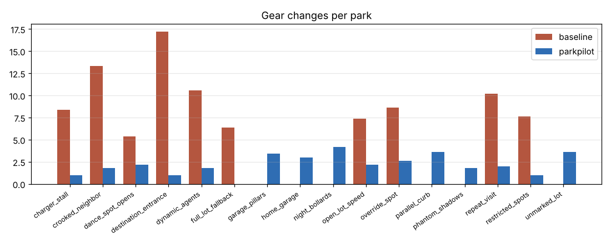
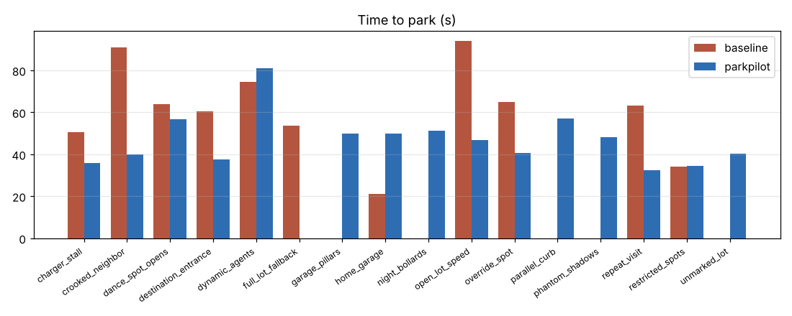

# Benchmark

Generated by `make bench` (`parkpilot bench`). Every scenario runs for both systems
over 5 seeds; numbers are computed from ground truth by
`parkpilot/metrics/run_metrics.py`. Nothing here is hand-edited.

Means over *parked* runs are marked; totals and rates are over all runs. Expected
handbacks (`full_lot_fallback`) are excluded from the success rate.

## Headline

| Metric | Baseline | ParkPilot |
|---|---:|---:|
| Park success rate (excl. expected handbacks) | 64% | 100% |
| Collisions (total) | 7 | 0 |
| Curb contacts (total) | 18 | 0 |
| Legality violations (total) | 10 | 0 |
| Missed hazards (total) | 0 | 0 |
| False stops (total) | 764 | 35 |
| Gear changes per park | 8.5 | 2.3 |
| Re-plans per park | 19.0 | 0.1 |
| Time to park (s) | 59.9 | 46.8 |
| Mean speed (m/s) | 0.60 | 1.19 |
| Peak jerk, raw (m/s^3) | 13.9 | 8.3 |
| Peak jerk excl. emergency stops (m/s^3) | 4.6 | 2.4 |
| Final lateral error (m) | 0.10 | 0.04 |
| Final heading error (deg) | 3.0 | 0.6 |
| Min side clearance at rest (m) | 0.93 | 0.84 |
| Walking distance (m) | 16.6 | 12.7 |
| Selection matches oracle | 30% | 100% |
| Abort/handback with reason | 0% | 100% |

## Per complaint

| # | Scenario | Metric | Baseline | ParkPilot |
|---|---|---|---:|---:|
| C1 | `dance_spot_opens` | gear changes | 5.4 | 2.2 |
| C1 | `dance_spot_opens` | re-plans | 17.2 | 0.0 |
| C2 | `open_lot_speed` | mean speed (m/s) | 0.75 | 1.85 |
| C2 | `open_lot_speed` | time to park (s) | 94.0 | 46.8 |
| C3 | `crooked_neighbor` | lateral error (m) | 0.24 | 0.04 |
| C3 | `crooked_neighbor` | min side clearance (m) | 0.27 | 0.48 |
| C4 | `destination_entrance` | oracle match | 0% | 100% |
| C4 | `destination_entrance` | walking distance (m) | 42.4 | 11.3 |
| C5 | `restricted_spots` | violations | 1.0 | 0.0 |
| C6 | `unmarked_lot` | success rate | 0% | 100% |
| C7 | `night_bollards` | collisions | 0.4 | 0.0 |
| C7 | `night_bollards` | min clearance (m) | 0.46 | 0.43 |
| C8 | `phantom_shadows` | false stops | 147.8 | 1.0 |
| C8 | `phantom_shadows` | missed hazards | 0.0 | 0.0 |
| C9 | `parallel_curb` | success rate | 0% | 100% |
| C9 | `parallel_curb` | curb distance error (m) | n/a | 0.03 |
| C10 | `garage_pillars` | success rate | 0% | 100% |
| C10 | `garage_pillars` | min clearance (m) | 0.79 | 0.38 |
| C11 | `charger_stall` | port-to-charger (m) | n/a | 0.48 |
| C11 | `home_garage` | port-to-charger (m) | 4.95 | 0.47 |
| C12 | `dynamic_agents` | collisions | 0.2 | 0.0 |
| C12 | `dynamic_agents` | yield events | 0.0 | 4.4 |
| C12 | `dynamic_agents` | time lost yielding (s) | 0.0 | 18.2 |
| C13 | `override_spot` | parked in driver's choice | 100% | 100% |
| C14 | `full_lot_fallback` | handback with reason | n/a | 100% |
| C14 | `full_lot_fallback` | violations | 1.0 | 0.0 |
| C15 | `repeat_visit` | repeat-visit match | 100% | 100% |
| C15 | `repeat_visit` | preference honored | 100% | 100% |

## Per scenario

| Scenario | System | parked | t park | gears | replans | lat err | hdg err | port | jerk | jerk excl. e-stop | oracle | min clr | coll | viol | false stops | missed |
|---|---|---:|---:|---:|---:|---:|---:|---:|---:|---:|---:|---:|---:|---:|---:|---:|
| `charger_stall` | baseline | 100% | 50.4 | 8.4 | 17.2 | 0.07 | 2.5 | n/a | 6 | 5.6 | 0% | 0.33 | 0.0 | 0.0 | 0.0 | 0.0 |
| `charger_stall` | parkpilot | 100% | 35.9 | 1.0 | 0.0 | n/a | 0.4 | 0.48 | 2 | 2.0 | 100% | 0.32 | 0.0 | 0.0 | 0.0 | 0.0 |
| `crooked_neighbor` | baseline | 60% | 91.0 | 17.4 | 27.4 | 0.24 | 1.6 | n/a | 12 | 5.6 | 60% | 0.31 | 0.2 | 0.0 | 0.6 | 0.0 |
| `crooked_neighbor` | parkpilot | 100% | 40.0 | 1.8 | 0.0 | 0.04 | 1.0 | n/a | 2 | 2.0 | 100% | 0.38 | 0.0 | 0.0 | 0.0 | 0.0 |
| `dance_spot_opens` | baseline | 100% | 64.0 | 5.4 | 17.2 | 0.06 | 3.6 | n/a | 40 | 3.6 | 100% | 0.30 | 0.2 | 0.0 | 2.6 | 0.0 |
| `dance_spot_opens` | parkpilot | 100% | 56.6 | 2.2 | 0.0 | 0.03 | 0.8 | n/a | 40 | 4.9 | 100% | 0.63 | 0.0 | 0.0 | 2.0 | 0.0 |
| `destination_entrance` | baseline | 100% | 60.6 | 17.2 | 30.2 | 0.22 | 2.2 | n/a | 6 | 6.0 | 0% | 0.34 | 0.0 | 0.0 | 0.0 | 0.0 |
| `destination_entrance` | parkpilot | 100% | 37.6 | 1.0 | 0.0 | 0.05 | 0.2 | n/a | 2 | 2.0 | 100% | 0.44 | 0.0 | 0.0 | 0.0 | 0.0 |
| `dynamic_agents` | baseline | 100% | 74.5 | 10.6 | 19.8 | 0.06 | 3.1 | n/a | 40 | 5.6 | 0% | 0.29 | 0.2 | 0.0 | 0.0 | 0.0 |
| `dynamic_agents` | parkpilot | 100% | 81.0 | 1.8 | 0.2 | 0.05 | 0.5 | n/a | 40 | 2.3 | 100% | 0.45 | 0.0 | 0.0 | 1.6 | 0.0 |
| `full_lot_fallback` | baseline | 100% | 53.8 | 6.4 | 14.6 | 0.08 | 3.4 | n/a | 12 | 5.0 | n/a | 0.29 | 0.0 | 1.0 | 0.0 | 0.0 |
| `full_lot_fallback` | parkpilot | 0% | n/a | 4.0 | 0.0 | n/a | n/a | n/a | 40 | 2.0 | n/a | 0.22 | 0.0 | 0.0 | 2.0 | 0.0 |
| `garage_pillars` | baseline | 0% | n/a | 21.2 | 22.0 | n/a | n/a | n/a | 6 | 5.8 | 0% | 0.79 | 0.0 | 0.0 | 0.0 | 0.0 |
| `garage_pillars` | parkpilot | 100% | 50.0 | 3.4 | 0.2 | 0.01 | 0.3 | n/a | 2 | 2.0 | 100% | 0.38 | 0.0 | 0.0 | 0.2 | 0.0 |
| `home_garage` | baseline | 100% | 21.0 | 0.0 | 7.0 | n/a | 0.0 | 4.95 | 2 | 2.0 | 100% | 0.44 | 0.0 | 0.0 | 0.0 | 0.0 |
| `home_garage` | parkpilot | 100% | 49.8 | 3.0 | 0.0 | n/a | 0.3 | 0.47 | 2 | 2.0 | 100% | 0.31 | 0.0 | 0.0 | 0.0 | 0.0 |
| `night_bollards` | baseline | 0% | n/a | 16.0 | 21.6 | n/a | n/a | n/a | 31 | 5.8 | 0% | 0.46 | 0.4 | 0.0 | 0.8 | 0.0 |
| `night_bollards` | parkpilot | 100% | 51.3 | 4.2 | 0.4 | 0.04 | 0.5 | n/a | 2 | 2.0 | 100% | 0.43 | 0.0 | 0.0 | 0.2 | 0.0 |
| `open_lot_speed` | baseline | 100% | 94.0 | 7.4 | 17.8 | 0.07 | 4.2 | n/a | 19 | 4.2 | 0% | 0.26 | 0.2 | 0.0 | 0.2 | 0.0 |
| `open_lot_speed` | parkpilot | 100% | 46.8 | 2.2 | 0.0 | 0.04 | 1.0 | n/a | 2 | 2.0 | 100% | 1.01 | 0.0 | 0.0 | 0.0 | 0.0 |
| `override_spot` | baseline | 100% | 65.0 | 8.6 | 21.0 | 0.11 | 5.3 | n/a | 5 | 4.8 | n/a | 0.35 | 0.0 | 0.0 | 0.0 | 0.0 |
| `override_spot` | parkpilot | 100% | 40.7 | 2.6 | 0.0 | 0.04 | 0.7 | n/a | 2 | 2.0 | n/a | 0.54 | 0.0 | 0.0 | 0.0 | 0.0 |
| `parallel_curb` | baseline | 0% | n/a | 13.4 | 18.6 | n/a | n/a | n/a | 19 | 5.1 | 0% | 1.82 | 0.0 | 0.0 | 0.4 | 0.0 |
| `parallel_curb` | parkpilot | 100% | 57.1 | 3.6 | 0.2 | 0.03 | 0.9 | n/a | 2 | 2.0 | 100% | 0.78 | 0.0 | 0.0 | 0.0 | 0.0 |
| `phantom_shadows` | baseline | 0% | n/a | 0.0 | 0.0 | n/a | n/a | n/a | 40 | 1.1 | 0% | 2.05 | 0.0 | 0.0 | 147.8 | 0.0 |
| `phantom_shadows` | parkpilot | 100% | 48.3 | 1.8 | 0.0 | 0.05 | 0.5 | n/a | 17 | 2.0 | 100% | 0.62 | 0.0 | 0.0 | 1.0 | 0.0 |
| `repeat_visit` | baseline | 100% | 63.1 | 10.2 | 24.4 | 0.07 | 2.9 | n/a | 11 | 4.2 | 0% | 0.34 | 0.2 | 0.0 | 0.2 | 0.0 |
| `repeat_visit` | parkpilot | 100% | 32.4 | 2.0 | 0.0 | 0.01 | 0.4 | n/a | 4 | 4.2 | 100% | 0.51 | 0.0 | 0.0 | 0.0 | 0.0 |
| `restricted_spots` | baseline | 100% | 34.2 | 7.6 | 14.4 | 0.10 | 3.8 | n/a | 5 | 4.8 | 0% | 2.05 | 0.0 | 1.0 | 0.0 | 0.0 |
| `restricted_spots` | parkpilot | 100% | 34.5 | 1.0 | 0.0 | 0.10 | 1.1 | n/a | 2 | 2.0 | 100% | 0.97 | 0.0 | 0.0 | 0.0 | 0.0 |
| `unmarked_lot` | baseline | 0% | n/a | 0.0 | 0.0 | n/a | n/a | n/a | 10 | 2.0 | 0% | 0.22 | 0.0 | 0.0 | 0.2 | 0.0 |
| `unmarked_lot` | parkpilot | 100% | 40.3 | 3.6 | 0.6 | 0.01 | 0.5 | n/a | 3 | 3.0 | 100% | 0.45 | 0.0 | 0.0 | 0.0 | 0.0 |

## Plots

## Notes on method

- *False stop*: a hard brake or a yield with no real agent within 6 m, no ground-truth
  time-to-contact under 3 s and no solid obstacle within 0.3 m.
- *Missed hazard*: an episode where the ego kept moving (|v| > 0.3 m/s) with a
  ground-truth time-to-contact with an agent under 0.5 s (predicted with the ego's
  current deceleration, so braking counts), or touched an agent.
- *Final lateral error*: distance from the ideal lateral position (centred between
  the actual neighbours, clamped to the painted lines) for perpendicular stalls, and
  the curb-gap error for parallel stalls.
- *Oracle*: the cheapest legal free stall under the same cost function, evaluated
  on ground truth, with availability judged when the system first commits. Not
  defined where the driver picks the spot (`override_spot`).
- *Peak jerk excl. emergency stops*: as raw peak jerk, ignoring 0.5 s around ticks
  where the safety supervisor commanded an emergency stop. Emergency braking ramps
  at 40 m/s^3 (brake build-up), comfort driving at 2 m/s^3.
- The baseline re-plans on a 2 s timer rather than every perception frame; every
  frame would make the benchmark impractically slow in pure Python and would only
  make the baseline worse.
